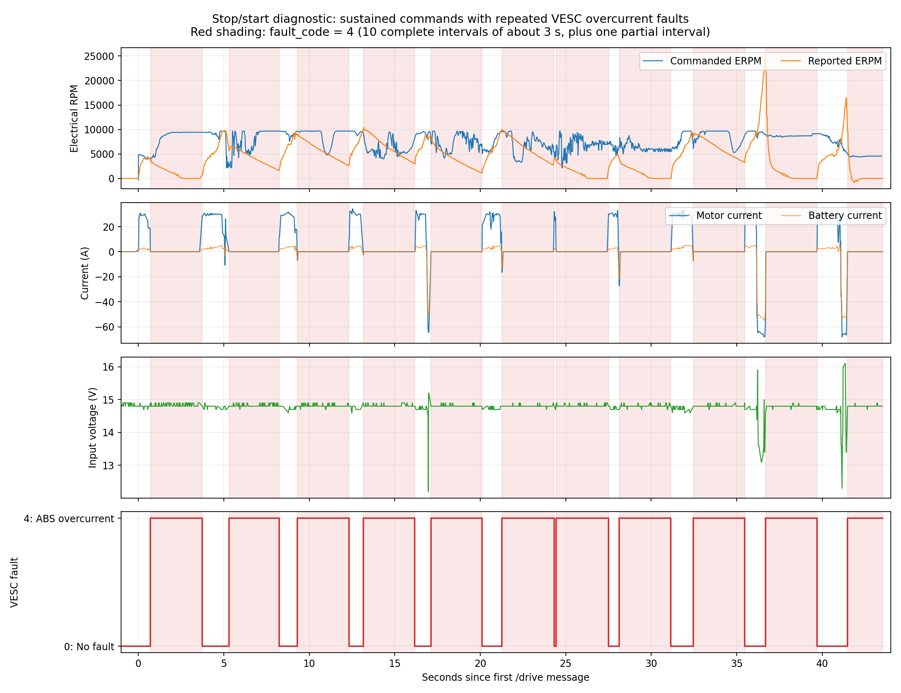
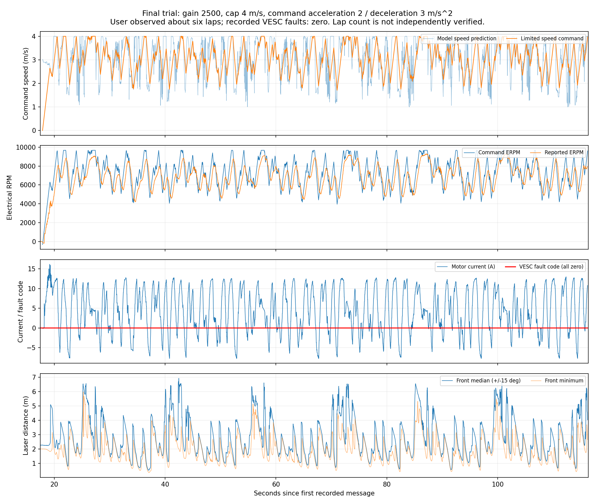

> 2026-11-12 폴더 정리: 이 문서의 경로·명령은 당시 기록이다. 현재 `results/imitation/2`는 `results/imitation/2_bc_mlp_4mps_verified_1080pts_1frame_realtest_20261110`이며, 전체 변경표는 [이동 기록](experiment_directory_migration_20261112.json)에 있다.

# 2026-11-10 작업 일지 — 학습 모델의 Jetson 배포와 실차 반복 주행

이 문서는 **2026년 11월 10일에 노트북에서 학습 모델을 Jetson으로 전달하고, ROS 2에 연결하고, 실차 문제를 진단하며 설정을 비교한 과정**을 시간순으로 정리한다. 작업에 참여하지 않은 팀원이 무엇을 왜 바꿨고 어떤 결과를 확인했는지 이해하고, 다음 작업을 이어받는 것이 목적이다.

오늘의 최종 상태는 **ERPM gain 2500, 목표 속도 상한 4m/s, 명령 가속 제한 2m/s²·일반 감속 제한 3m/s²**다. 마지막 시험에서 사용자가 약 6바퀴 주행을 관찰했고, 전송된 rosbag에서는 약 98초의 주행 명령 구간 동안 VESC 오류가 기록되지 않았다. 이것이 다른 트랙이나 다른 설정에서도 무충돌 주행을 보장한다는 뜻은 아니다.

## 1. 이 문서의 시간과 증거를 읽는 방법

- 모든 절대시각은 **한국 표준시 KST, UTC+09:00, Asia/Seoul**이다. 날짜를 생략한 시각도 모두 2026-11-10이다.
- **Git 시각**은 커밋의 작성자 시각이다. 편집·시험이 실제로 시작된 순간과 같다고 가정하지 않는다. 작성자·커미터 시각 원문을 별도 증거 파일에 함께 남겼다.
- **rosbag 시각**은 SQLite `messages.timestamp`의 첫·마지막 메시지 수신 시각이다. 개별 이벤트는 같은 시작 시각에 분석용 상대시간을 더해 환산했다. 모든 장치의 시계 동기화 정확도를 별도로 측정한 것은 아니다.
- **폴더명 끝의 시각**은 명령에서 `date`로 만든 이름이다. 실제 첫 메시지 시각과 다르므로 주행 시작 시각으로 사용하지 않는다. 예를 들어 마지막 폴더명은 `20261110_202552`지만 첫 메시지는 **20:26:38.276**이다.
- **시각 미확정**은 대화에서 작업 순서는 확인되지만 개별 명령의 절대시각을 확인할 원자료가 없다는 뜻이다. 초 단위 시각을 임의로 만들지 않았다.
- **사용자 관찰**과 **로그로 확인한 사실**, **가능성에 대한 해석**을 구분한다. 약 6바퀴는 사용자 관찰이다. 자동 랩 카운터나 외부 위치 측정으로 다시 센 값은 아니다.

시각·메시지 수·오류 구간·원본 DB 해시의 기계 판독용 근거는 [타임라인 원자료](sim2real_20261110_timeline.json), 최종 설정과 시험 요약은 [당일 상태 보고서](sim2real_20261110.json)에 있다. 이 문서의 Git 이력은 본 문서 작성 직전의 `27edfd6`까지를 대상으로 한다.

## 2. 시작할 때 이미 준비되어 있던 것

### 2.1 오늘 새로 학습한 것은 아니다

오늘 가져온 신경망은 **11월 7일에 학습·평가한 `imitation/2` 모델**이다. 오늘은 이 모델을 다시 학습하지 않았고, 실차 시험 중에도 가중치와 입력 정규화 파일을 교체하지 않았다.

- 입력: 한 프레임의 라이다 거리 **1,080개**.
- 출력: 정규화된 조향과 목표 속도 **2개**.
- 구조: `1080 → 256 → 256 → 2` MLP.
- 학습 자료: 전문가 샘플 95,463개, 미니배치 업데이트 5,000회.
- 실제 배포 대상으로 선택된 체크포인트: **4,000회 업데이트 시점**.
- 기존 시뮬레이션 최종 평가: 학습에 포함된 23개 트랙의 별도 시작 조건에서 **230/230 완주**.
- 위 시뮬레이션 결과는 실차 보정 정확도, 새로운 트랙 일반화, 실차 무충돌을 검증한 결과가 아니다.

세부 내용은 [기존 학습 보고서](../src/f1tenth/imitation_training_report.md)를 참고한다. 전문가 수정·데이터 수집·평가 코드 중 일부는 이미 만들어져 있었지만 미커밋 상태였고, **오늘 20:23:20에 저장소에 함께 반영**했다. 그 커밋 시각을 알고리즘 최초 구현·학습 시각으로 해석하면 안 된다.

### 2.2 두 컴퓨터와 소프트웨어 환경

| 구분 | 노트북 | Jetson |
|---|---|---|
| 사용자·호스트 | `jiwon@jiwon-16Z90SP-ED7BK` | `team2@ubuntu` |
| 프로젝트 | `/home/jiwon/projects/Autonomous-Driving-2026-team2` | `/home/team2/Autonomous-Driving-2026-team2` |
| 모델 실행용 가상환경 | `/home/jiwon/venv/torch210` | `/home/team2/venv/torch210` |
| Python | 3.8.10 | 3.8.10 |
| PyTorch | 2.1.0+cu118 | 2.1.0a0+41361538.nv23.06 |
| GPU | RTX 3050 Laptop, 기존 학습 환경 | `torch.cuda.is_available() == True` 확인 |
| ROS 2 | 로컬 ROS 실행 검증 환경은 없음 | Foxy, 실제 드라이버와 ROS 노드 실행 |
| 저장소 | 두 컴퓨터 모두 같은 GitHub 저장소의 `main` | 동일 |

GitHub 저장소는 `https://github.com/ihjkongs/Autonomous-Driving-2026-team2.git`이다. Jetson에는 기존 `/home/team2/ros2_ws/install`도 있어서, 새 프로젝트에서 빌드하지 않은 드라이버는 그 설치본을 사용하는 상황이 확인됐다.

## 3. 13:31 이전 — SSH 접속과 모델 전달 방법 정리

**정확한 개별 시각은 미확정. 첫 배포 커밋보다 앞선 순서로 대화에서 확인된다.**

1. 같은 프로젝트와 저장소가 있어도, 노트북에서만 만들어진 모델 파일이 Jetson에 자동으로 존재하지는 않는다는 점을 확인했다.
2. `src/f1tenth/.gitignore`가 `results*`, `*.pkl`, 영상 등을 제외하고 있었다. 모델을 GitHub로 전달하려면 예외 설정과 `add → commit → push → Jetson에서 받기`가 필요했다.
3. 처음 사용한 `ssh team2@192.168.0.15`는 응답 없이 대기했고, `ConnectTimeout=5`를 붙이자 `Connection timed out`이 확인됐다. 해당 주소가 당시 올바른 주소였는지는 확인되지 않았다.
4. `hostname -I`에 주소가 여러 개 나올 수 있고, 같은 네트워크의 두 장치도 IP는 서로 달라야 한다는 점을 설명했다. 첫 번째 주소가 항상 SSH에 쓸 주소인 것은 아니다.
5. 접속 후 `whoami → team2`, `hostname → ubuntu`, `pwd → /home/team2`로 실제 Jetson 접속을 확인했다. 홈 디렉터리에서 프로젝트를 찾았다.
6. Jetson 프로젝트가 `main`, 같은 remote, 수정 파일 없는 상태임을 확인했다.
7. 기본 `python3`에서는 `No module named 'torch'`가 났지만, `source ~/venv/torch210/bin/activate` 후 PyTorch와 CUDA가 정상 동작했다. PyTorch 재설치를 진행한 것은 아니다.

모델 전달용 압축 파일을 따로 준비해 둔 경로도 있었지만, 실제로 선택해 사용한 배포 경로는 **GitHub로 코드와 필요한 모델 파일을 전달하는 방식**이었다. x86 노트북의 가상환경을 ARM Jetson에 통째로 복사하지 않았다.

## 4. 13:31:44~13:50:19 — 모델 배포와 강의 8번의 ROS 연결 구현

### 4.1 13:31:44 — 모델 파일을 Git에 포함

커밋 `5751d80` — `Add trained imitation model and loading support`.

`.gitignore` 전체를 해제하지 않고, 다음 배포 파일만 Git 관리 대상에 포함했다.

```text
src/f1tenth/results/imitation/2/
├── sim2real/
│   ├── actor.pt                   # 학습된 신경망, 약 1.4MB
│   ├── agent_obs_scale.pkl        # 학습 때의 입력 평균·분산
│   └── agent_reward_scale.pkl    # 현재 실차 추론에서는 필수 사용 파일 아님
└── backup/
    └── f1tenth.yaml              # 모델 입출력 차원·속도·조향 변환 설정
```

영상, 중간 체크포인트, 대용량 전문가 데이터셋 전체를 배포 커밋에 넣지는 않았다. 모델의 Python 클래스 경로를 Jetson에서도 읽을 수 있도록 `algorithm/__init__.py`, `algorithm/common/models.py`의 로딩 지원 변경도 포함했다. 모델 자체를 새로 학습한 커밋은 아니다.

노트북에서 `git commit` 시 작성자 정보가 없어 실패했다. 저장소 범위의 `git config user.name`, `git config user.email`을 설정한 뒤 재시도해 성공했다. **실패한 commit 다음의 `Everything up-to-date`는 변경 업로드 성공을 의미하지 않는다**는 점도 확인했다.

Jetson에서 공개 저장소를 받는데 인증 입력이 요구됐다. 브라우저 시크릿 창에서도 저장소가 보이는 것을 확인한 뒤, 구글 비밀번호나 토큰을 넣지 않고 다음 방식으로 공개 URL에서 가져왔다.

```bash
git -c credential.helper= -c core.askPass= fetch \
  https://github.com/ihjkongs/Autonomous-Driving-2026-team2.git main
git merge --ff-only FETCH_HEAD
```

이 방식은 오늘 이후 동기화에도 사용했다. 공개 저장소의 **읽기**에 인증이 필요 없다는 것과 **쓰기(push)**에는 권한·인증이 필요하다는 것은 별개다.

### 4.2 배포 후 모델만 단독 실행 — 정확한 시각 미확정

Jetson에서 `actor.pt`를 CPU로 불러와 가짜 입력 `zeros(1, 1080)`을 넣었다.

```text
모델 로딩 및 CPU 계산 성공
입력 크기: (1, 1080)
출력 크기: (1, 2)
시험 출력: [[0.021339396..., 0.475903123...]]
```

사용자가 후속으로 **GPU 계산 성공** 메시지도 확인했다. 이 시험은 역직렬화와 계산 가능 여부를 검증했을 뿐, 실제 라이다 반응이나 차량 주행을 검증한 것은 아니다. 차량 구동 명령도 보내지 않았다.

### 4.3 13:43:24 — 미완성 실차 노드 구현

커밋 `e7e1893` — `Implement LiDAR policy node with dry-run predictions`.

기존 `agent_node.py`에는 `obs_dim`이 비어 있었고 `getObs`도 미완성이었다. `src/f1tenth`를 현재 실행 위치 기준으로 찾는 문제도 있었다. 다음을 구현했다.

- `project_root`로 모델 경로를 명시해 실행 위치 의존성을 줄였다.
- 학습 모델과 같은 1,080차원 입력, 학습 때 저장한 평균·분산으로 정규화했다.
- 실차 `LaserScan`의 각도 정보를 사용해 시뮬레이터의 **4.7rad 시야, 1,080개 광선**에 맞게 재표본화했다. 실차 측정값 1,081개를 앞에서 단순히 자르는 방식으로 처리하지 않았다.
- 거리 단위는 m를 유지하고, 시뮬레이터 최대 거리 30m 기준을 적용했다. 비정상 값·부족한 각도 범위 등을 검사했다.
- 조향·속도를 학습 설정에 따라 실제 명령 단위로 변환했다.
- 기본 `dry_run=true`에서는 `/drive` 발행자를 만들지 않고 `/agent/prediction`만 발행하도록 했다.
- 센서 입력 오류·시간 초과 시 정지 명령을 보내는 처리를 추가했다.
- 라이다 구독 QoS, 패키지 실행 의존성, 테스트를 정리했다.

이때의 오류·시간 초과 정지는 **충돌 감지기나 장애물 앞 자동 정지 기능이 아니다**. 이후 정상 입력이 돌아오면 다시 명령을 내보내는 동작이었다.

### 4.4 13:50:19 — 새로 받은 강의 8번에 맞춰 launch 연결

커밋 `606674b` — `Complete lecture 8 sim2real policy integration`.

[8. Imitation Learning-Sim2real.pptx.pdf](<../lecture note/8. Imitation Learning-Sim2real.pptx.pdf>)를 확인했다. 강의의 핵심 TODO는 다음이었다.

1. `agent_node`를 `ackermann_mux`에 연결.
2. 모델과 같은 관측 차원 설정.
3. 학습 때의 `getObs` 처리 반영.
4. `results` 배치와 `agent.yaml`의 모델 이름·번호 설정.
5. `bringup_launch.py`에서 에이전트 실행 연결.

앞서 별도 노드로 실행할 수 있게 만든 것에 더해, `bringup_launch.py`가 모델 노드를 함께 실행하도록 수정했다. `enable_agent`, `dry_run`, `project_root`, `agent_python` 인자를 연결했다. `agent_python`은 PyTorch가 설치된 Jetson 가상환경의 Python을 명시하는 데 사용했다.

강의의 `results/imitation/1`은 예시였고, 실제 사용 모델은 **`imitation/2`**로 맞췄다. 강의는 `scp` 전달 예시를 사용하지만, 우리 모델·코드 전달은 GitHub로 같은 목적을 달성했다.

## 5. 초기 dry-run 확인과 강의자료 동기화

**13:50 이후, 17:50 이전. 일부 작업의 개별 절대시각은 미확정이다.**

- Jetson에서 `colcon build --symlink-install --packages-select f1tenth_stack`를 실행했다.
- 기존 `ros2_ws/install`에서 일부 VESC·mux 패키지를 사용한다는 경고가 나왔지만, 선택한 `f1tenth_stack` 빌드는 성공했다. 기존 설치본을 사용하는 경고와 실행 실패를 구분했다.
- `ros2 node list`가 비어 있고 `/parameter_events`, `/rosout`만 보이는 상태를 확인한 후 bringup을 실행했다.
- 라이다·VESC·mux·모델 노드가 함께 실행되고 모델이 GPU에서 라이다를 처리하는 것을 확인했다.
- 라이다 앞·옆 물체 위치를 바꾸며 거리 값과 모델 출력이 변하는지 확인했다. 거리 확인 스크립트에서는 정면 약 3.61m가 물체 접근 시 0.05~0.12m 등으로 변했다.
- 처음에는 연속 로그를 복사하기 어려워 `timeout`, `grep`, `tail`로 일부만 수집하려 했으나 출력이 안 나왔다. 이후 환경을 다시 불러오고 메시지 타입을 명시한 `ros2 topic echo`로 실제 예측 수신을 확인했다.

```bash
ros2 topic echo /agent/prediction \
  ackermann_msgs/msg/AckermannDriveStamped \
  --qos-reliability best_effort
```

샘플 중 조향 약 `+0.4764rad`, 속도 4m/s처럼 상한에 가까운 출력도 있었다. 이후 사용자가 물체 위치에 따라 출력이 바뀌는 것을 확인했다. **출력이 반응한다는 것과 올바른 회피·완주 제어라는 것은 구분했다.**

**14:36:30**, 커밋 `c000eda` — `Add lecture notes`로 `lecture note/`의 강의자료도 저장소에 반영했다. 강의자료 추가만으로 ROS 빌드가 필요한 것은 아니다.

## 6. 17:50~18:03 — 실구동을 막던 설정 오류 두 가지 해결

### 6.1 17:50:20에 시작한 launch — 정수/실수 자료형 오류

사용자가 제공한 launch 로그의 경로는 `2026-11-10-17-50-20-...`였다. `ackermann_to_vesc_node`, `vesc_to_odom_node`가 다음 오류로 종료됐다.

```text
rclcpp::ParameterTypeException
expected [double] got [integer]
```

이때 노트북과 Jetson 설정이 달라, 먼저 Jetson의 변경을 Git으로 전달해 확인하기로 했다.

**17:57:27**, 커밋 `aa89890` — `Update vehicle calibration and keyboard controls`:

| 항목 | 이전 저장소 값 | Jetson에서 편집해 전달한 값 |
|---|---|---|
| `speed_to_erpm_gain` | 3500.0 | **2500**, 정수 표기 |
| `steering_angle_to_servo_gain` | −0.845 | **+1.0** |
| `steering_angle_to_servo_offset` | 0.494 | **0.53** |
| 키보드 조향 명령 | ±0.48 | **±0.6** |
| 키보드 전·후진 rate | 1.0 | **2.0** |

정확한 편집 순간은 확인되지 않는다. 위 시각은 이미 Jetson에 있던 변경을 저장한 커밋 시각이다. Jetson에서도 작성자 정보가 없어 commit이 한 번 실패했고, 저장소 범위의 작성자 설정 후 성공했다. 처음 `git add`만 한 상태에서는 노트북이 `Already up to date`라고 나오는 원인도 확인했다.

노트북에서 받은 파일의 `speed_to_erpm_gain: 2500`을 찾았다. C++ 노드가 `double`로 읽으므로 **값을 바꾸지 않고 `2500.0`으로 표기만 수정**했다.

**17:58:36**, 커밋 `3e38d01` — `Fix VESC speed gain parameter type`.

Jetson에서 업데이트·재빌드 후 **17:59:28**에 시작한 dry-run launch에서는 해당 예외가 사라졌고, VESC firmware `4.2`, Hokuyo ID `B2232705`, 라이다 스트리밍 연결 로그가 확인됐다. 이어 모델 GPU 로딩과 약 40Hz 입력 처리가 확인됐다.

### 6.2 18:01:13에 시작한 launch — false를 줘도 dry-run 유지

명령에는 `dry_run:=false`를 넣었지만 실제 로그에는 다음과 같이 나왔다.

```text
Model loaded on cuda:0; dry_run=True
```

이 상태에서는 `/drive`를 발행하지 않으므로 차량이 움직이지 않는 것이 코드 동작과 일치했다. YAML과 실행 인자를 여러 파라미터 소스로 전달하는 방식을 바꿔, `_launch_agent`에서 YAML을 읽고 실행 인자를 덮어쓴 **하나의 파라미터 사전**을 노드에 전달하도록 수정했다.

**18:03:07**, 커밋 `6dc2163` — `Fix dry-run launch parameter override`.

수정 후 사용자가 실제 구동을 확인했다. 바퀴를 띄워 전진 방향·조향 방향·종료 시 정지를 확인하고 바닥 시험으로 넘어가는 순서를 안내했다. 이 커밋이 이후 **가감속 제한을 넣기 전 상태로 되돌릴 때의 기준 버전**이 됐다.

## 7. 18:03 이후~18:25 — 속도 상한 조정과 첫 stop/start 기록

### 7.1 속도 상한과 보정 gain을 구분

초기 `speed_limit`은 1m/s여서 느리다는 피드백이 있었다. 대화에서는 1.5, 2.5, 이후 4m/s 상한으로 높여 시험하는 명령을 안내했다. 개별 설정 변경의 정확한 시각과 모든 중간 시험의 적용 여부는 연속 기록이 없어 확정하지 않는다.

`forward_rate`는 키보드 조작용 설정이고, 모델의 `/drive` 속도 상한과는 별개라고 설명했다. 모델의 속도 출력 범위는 `backup/f1tenth.yaml` 기준 **1~4m/s**라서, `speed_limit`만 5로 올려도 모델이 5m/s를 요구하지는 않는다.

사용자는 차량이 가다 서는 현상을 보고했다. 초당 약 40회의 모델 로그에는 양수 속도가 계속 보여 다음 세 단계의 명령과 실제 상태를 분리해서 확인하기로 했다.

```text
모델 예측 → /drive → mux → /ackermann_cmd
                           ↓
                  /commands/motor/speed → VESC 실제 상태
```

### 7.2 기록 A — 18:24:27.714~18:25:29.427

폴더: `drive_stop_check_20261110_182416`.

- 기록 메시지 17,123개, 총 약 61.71초.
- `/ackermann_cmd` 구간: **18:24:45.897~18:25:29.366**, 약 43.47초.
- gain 2500, 속도 상한 4, 추가 가감속 제한 도입 전.
- 시작 직후를 제외한 속도 0 명령 없음. `/teleop` 기록도 없어 키보드 우선순위 개입 증거가 없었다.
- 모터 명령 최대 간격 약 0.056초로 명령은 계속 전달됐다.
- **`fault_code=4`가 11회 발생**했다. 끝까지 기록된 10회는 각각 약 3초였고, 마지막 회차는 기록 끝에서 잘렸다.
- 전류 범위 −68.06~34.19A, 입력 전압 12.2~16.1V.

대표 오류 시각은 **18:24:46.599~18:24:49.633**이다. 이후 유사한 차단·복구가 반복됐다. VESC 공식 4.02 소스와 프로젝트 메시지 정의를 대조해 코드 4가 **절대 과전류 보호 `FAULT_CODE_ABS_OVER_CURRENT`**임을 확인했다.

첫 전송에는 `metadata.yaml`이 없고 `.db3`, `.db3-wal`, `.db3-shm`이 함께 있었다. 이를 곧바로 정상 종료된 완전한 rosbag으로 취급하지 않았다. 전달된 WAL을 포함해 SQLite의 일관된 백업을 만들고 무결성을 확인해, 전달된 약 62초 구간을 분석했다. 원래 전체 시험의 시작·끝이 모두 들어 있다고 단정하지 않는다.



첫 분석에서 확인한 직접 현상은 **전진 명령 유지 → 과전류 보호 → 출력 차단·회전수 감소 → 복구 후 재구동**이었다. 왜 과전류가 생기는지는 다음 단계에서 조사했다.

## 8. 첫 기록 분석 이후~19:18 — VESC 설정 확인과 Speed PID 조정

### 8.1 `faults` 조회와 전류 설정 확인

ROS를 종료하고 VESC Tool의 **VESC Dev Tools → Terminal**에서 `faults`를 조회하도록 안내했다. 이는 SSH 터미널 명령이 아니라 VESC Tool을 통해 컨트롤러의 오류 이력을 읽는 명령이다.

사용자는 `No faults registered since startup`을 확인했다. 이 메시지는 **현재 부팅 이후의 이력**에 관한 것이므로 이전 rosbag의 과전류를 부정하지 않는다. 전원을 재시작하면 과거 이력이 없을 수 있다는 점을 설명했다. 해당 조회 이전에 실제로 전원을 재시작했는지는 별도 증거가 없다.

사용자가 알려준 전류 설정은 다음과 같았다.

| 설정 | 값 |
|---|---:|
| Motor Current Max | 30A |
| Motor Current Max Brake | −30A |
| Absolute Maximum Current | 80A |

모터 전류 제한 30A와 절대 과전류 보호 80A는 역할이 다르며, 평균 전류 텔레메트리가 80A 미만이어도 순간적인 과전류 보호를 배제할 수 없다고 설명했다. **80A 보호 한계를 높이거나 오류 후 대기 시간을 줄이는 수정은 하지 않았다.**

### 8.2 19:06:36·19:06:45 화면 — 높은 Speed Kp 확인

사용자가 보낸 스크린샷 파일명에 각각 `19-06-36`, `19-06-45`가 있다. 이는 화면 확보 시각의 단서이며, VESC에 설정을 쓴 정확한 시각은 아니다.

| 항목 | 화면에서 확인한 값 |
|---|---:|
| Speed PID Kp | **0.80000** |
| Speed PID Ki | 0.00003 |
| Speed PID Kd | 0 |
| Minimum ERPM | 1000 |
| Allow Braking | True |
| Sensor Mode | Sensorless |
| Motor Resistance | 7.3mΩ |
| Motor Inductance | 0.87µH |
| Motor Flux Linkage | 0.888mWb |
| FOC Current Kp / Ki | 0.0017 / 14.58 |
| Observer Gain, 화면 x1M 단위 | 1268.16 |

속도 PID는 속도 오차를 전류 요구로 바꾸고, FOC 전류 PI는 실제 전류를 제어한다. 서로 다른 게인이다. 공식 4.02 속도 제어 소스에서는 P항이 `속도 오차 × Kp / 20`이므로 Kp 0.8이면 오차 25 ERPM만으로도 P항이 정규화된 상한에 도달할 수 있었다. 같은 소스의 일반 기본 Kp는 0.004였다.

**Kp만 0.80000에서 0.00400으로 낮춰 비교**하고 Ki·Kd, FOC 측정값과 전류 제한은 유지하도록 했다. 이후 사용자가 구동이 좋아졌다고 확인했다. VESC 설정은 저장소 YAML이 아니라 컨트롤러에 저장되므로, rosbag만으로 실제 Kp 값을 독립적으로 읽어 확인한 것은 아니다. 보고서에는 사용자 적용·관찰을 근거로 표시했다.

이 과정에서 모터 R/L/자속을 새로 측정하거나 FOC 전류 게인을 변경하지는 않았다. Speed PID를 바꾸는 데 `colcon build`가 필요한 것도 아니다.

### 8.3 속도 재조정과 기록 B — 19:17:25.502~19:18:25.803

Kp 조정 후 사용자는 속도 상한 3에서 구동 개선을 확인했다. 이후 3.5 제안, 5 요청, 모델 최대 4 설명을 거쳐 **4 상한으로 시험**했다. 5m/s 모델로 바꾸거나 재학습하지는 않았다.

폴더: `drive_check_20261110_191704`.

- 총 약 60.30초, 17,250개 메시지.
- 명령 구간: **19:17:43.072~19:18:25.799**, 약 42.73초.
- 과전류 3회: **19:17:45.862**, **19:17:54.970**, **19:18:11.762**에 시작해 각각 약 3초 유지.
- 전류 −18.23~32.39A, 전압 14.5~14.8V. 초기 기록보다 변화 폭이 줄었다.
- 세 오류 직전에 목표 속도 급락이 있었다. 예: 4.00→1.90, 4.00→1.57, 3.74→1.04m/s가 약 20~30ms 간격의 메시지 사이에서 발생했다.

이는 **급한 감속·제동이 남은 과전류와 관련될 가능성**을 보여줬지만, 전류 제어·센서리스 상태까지 포함한 근본 원인을 하나로 확정한 것은 아니다.

[Kp 조정 후 과전류 직전 확대 그래프](figures/20261110/after_pid_fault_details.png).

## 9. 19:29:42~19:38 — 모델 뒤에 가감속 제한 추가

### 9.1 19:29:42 — 제한기 구현·저장

커밋 `84da800` — `Limit policy speed command acceleration and deceleration`.

사용자가 모델 출력 후처리 추가 개념을 확인했고, **학습된 모델은 유지한 채 차량에 보내는 속도의 변화량을 제한**하는 코드를 구현했다.

```text
라이다 → 정규화 → 기존 모델 → 목표 속도 상한 → 가감속 제한 → /drive
```

- 가속 제한: 2m/s².
- 일반 감속 제한: 3m/s².
- 최초 유효 입력에서 0부터 시작하고, 단조 증가 시계의 실제 호출 간격으로 변화량을 계산한다.
- 콜백이 늦었다고 한 번에 큰 속도 변화를 허용하지 않도록 계산 간격 상한을 둔다.
- 센서 오류·시간 초과·종료 정지는 일반 감속 제한을 우회하고 제한기 상태를 초기화한다.
- `/agent/prediction`: 원래 모델 예측.
- `/agent/command_preview`: 제한 후 명령, dry-run에서도 확인 가능.
- `speed_limit`, `max_acceleration`, `max_deceleration`을 launch 인자로 조정할 수 있게 했다.

관련 테스트 31개가 통과했다. 기록 B의 명령 1,713개를 오프라인 재생해 변화량이 제한되는 것을 확인했다. 이는 명령 재생 검사이며, 변경된 차량 움직임·전류·충돌까지 물리 시뮬레이션한 시험은 아니었다.

**도입 당시부터 남긴 주의점:** 일반 감속을 완만하게 하면 모델이 속도를 낮춰도 최종 명령은 잠시 더 높게 유지될 수 있다. 따라서 과전류 완화와 코너 감속 성능을 함께 확인해야 했다.

### 9.2 기록 절차 정리와 기록 C — 19:38:12.813~19:38:47.867

처음 `ls ~/drive_smooth_check_*`에서 폴더가 없었다. 주행 launch만으로는 rosbag이 자동 생성되지 않으므로 별도의 `ros2 bag record`가 필요하다는 점을 확인했다. 상한 1에서 너무 느리다는 피드백에 3, 이후 4로 시험 명령을 바꿨다.

폴더: `drive_smooth_check_20261110_193811`.

- gain 2500, 상한 4, 가속 2·감속 3.
- 총 약 35.05초, 13,160개 메시지. 이미 움직이는 중에 기록이 시작됐다.
- VESC 오류 0회. 전류 −7.29~12.94A, 전압 14.4~14.7V.
- 모델 예측의 한 메시지 간 최대 속도 변화 약 2.68m/s가 최종 명령에서는 약 0.10m/s로 줄었다.
- 같은 라이다 프레임의 preview와 `/drive` 1,392쌍이 정확히 일치했다.
- 서보 상한 초과 로그가 4건 있었다.

이때는 과전류 완화가 확인됐다. 다만 짧은 구간이고, 기록만으로 전체 시험의 무충돌·반복 완주를 확정하지 않았다.

## 10. 19:46~20:00 — gain을 높인 두 시험과 충돌 분석

### 10.1 보정 gain은 속도 상한과 다르다

사용자가 원래 gain 3500을 물었고, 같은 목표 속도에서 gain을 올리면 더 높은 ERPM을 요구한다는 점을 설명했다. 수치는 물리 속도 보정을 위한 것이므로 임의 변경 후 `/odom` 숫자만으로 실제 속도가 맞다고 확인할 수 없다.

오프셋 −325에서 목표 4m/s의 계산 결과는 다음과 같다.

| gain | 모터 목표 ERPM |
|---:|---:|
| 2500 | 9,675 |
| 2800 | 10,875 |
| 3200 | 12,475 |
| 3500 | 13,675 |

**3500은 설명·검토만 했고, 이번 기록들에서 3500 주행을 수행했다는 증거는 없다.**

### 10.2 19:46:33에 3200으로 변경 → 기록 D와 충돌

커밋 `c3f13e2` — `Set speed to ERPM gain to 3200 for testing`.

먼저 상한 3 비교를 안내했지만 사용자는 4에서 시험하기로 했다. 가속 2·감속 3은 유지했다.

폴더: `drive_gain3200_check_20261110_194959`.

- 실제 기록: **19:50:01.358~19:50:24.778**, 약 23.42초, 7,255개 메시지.
- 최대 목표 12,475 ERPM으로 gain 3200이 실제 적용된 것을 확인했다.
- 받은 상태에서 최대 11,498 ERPM, 전류 −5.95~21.50A.
- 사용자가 **충돌**을 보고했다.
- VESC 상태와 `/odom`이 약 **19:50:15.941**에서 끊겼지만 명령과 라이다 처리는 계속됐다.
- **19:50:17.129**부터 라이다의 `range_min` 미만 값으로 입력 거부가 반복됐다.
- 받은 VESC 상태는 모두 오류 0이었지만, 수신이 끊긴 이후의 오류를 배제할 수는 없다.

사용자에게 충돌 직후 전원을 껐는지 물었고 **전원은 켜 둔 상태**였다는 답을 받았다. 따라서 의도적인 전원 차단으로 데이터 중단을 설명하지 않았다. USB·시리얼 연결, 컨트롤러 리셋, 수신 경로 등의 가능성은 남았으며, 커널 로그 조회를 요청했지만 그 결과는 이번 대화에 제공되지 않았다.

또한 입력 오류에서 정지한 뒤 정상 입력이 들어오면 다시 양수 속도를 내보내는 **자동 재출발 동작**을 확인했다. 이는 충돌 후 정지를 유지하는 latch 기능이 구현되어 있지 않기 때문이다.

[3200 시험 타임라인](figures/20261110/gain3200_timeline.png). 충돌의 정확한 순간은 영상·충돌 센서·당시 `/scan` 기록이 없어 확정하지 않았다.

### 10.3 19:55:35에 2800으로 변경 → 기록 E와 충돌

커밋 `a883329` — `Set speed to ERPM gain to 2800 for testing`.

사용자 요청으로 gain을 2800으로 낮췄다. 상한 4, 가속 2·감속 3은 유지했다. 이번에는 충돌 접근을 분석하기 위해 **`/scan`을 rosbag에 추가**했다.

폴더: `drive_gain2800_check_20261110_195619`.

- 실제 기록: **19:57:36.718~19:58:26.463**, 약 49.74초, 17,022개 메시지.
- 명령 구간: **19:57:54.132~19:58:26.400**.
- VESC 상태가 끝까지 들어왔고 오류는 모두 0이었다. 3200 시험의 통신 중단과는 구분했다.
- 사용자가 다시 충돌했다고 보고했고, 위치는 **정면 또는 앞 모서리**라고 확인했다.
- 정면 ±15° 중앙값이 **19:58:23.241**에 30cm 미만으로 내려갔다.

충돌 접근 구간에서 같은 라이다 헤더를 기준으로 모델 예측과 최종 명령을 연결했다.

| 기록 시작 후 | 정면 중앙값 | 모델 목표 | 최종 속도 명령 |
|---:|---:|---:|---:|
| 45.99초 | 1.26m | 3.95m/s | 3.53m/s |
| 46.29초 | 0.45m | 2.05m/s | **2.79m/s** |
| 46.69초 | 0.13m | 2.17m/s | **2.25m/s** |
| 48.00초 | 0.13m | 2.19m/s | **2.19m/s** |

여기서 두 사실을 구분했다.

1. 모델 자체가 매우 가까운 벽에서도 전진을 요구했다. 현재 학습 모델의 출력 범위에는 정지 0m/s가 없다.
2. 추가한 일반 감속 제한이 모델 요청보다 높은 속도를 유지해 감속을 늦춘 구간이 실제로 있었다. 이를 단순히 과전류가 줄었으므로 좋은 변경이라고만 평가할 수 없었다.

레이저 기준 거리는 범퍼 간격과 다르며, 정확한 접촉 시각은 별도 센서 없이 확정하지 않았다. 충돌 뒤처럼 보이는 근거리 구간에서도 양수 명령이 계속 나온다는 것은 확인했다.

[2800 접근 그래프](figures/20261110/gain2800_approach.png) · [같은 구간의 라이다 스냅샷](figures/20261110/gain2800_lidar.png).

## 11. 20:00 이후~20:13 — 감속 제한 제거 가설을 실제로 비교

### 11.1 raw 모드 초안과 사용자 요청 정정

사용자는 일반 감속 제한 때문에 충돌했을 가능성을 제기하고, 모델의 입출력만으로 비교하고자 했다. 처음에는 기존 제한기를 남겨두고 `speed_control_mode:=raw`로 우회하는 코드를 작성했고 테스트 33개를 통과했다.

그러나 사용자는 **모드를 추가하는 것이 아니라 가감속 제한 도입 전 상태로 완전히 돌아가고 gain만 2800으로 유지하는 것**이라고 명확히 정정했다.

따라서 **raw 모드 초안은 채택·커밋하지 않았다.** 최종 코드에 raw/limited 전환 기능이 남아 있다고 해석하면 안 된다.

### 11.2 20:11:11 — 제한 도입 전 코드로 실제 복구

커밋 `271db1d` — `Restore pre-limiter driving code and keep gain 2800`.

- `agent_node.py`, `bringup_launch.py`를 가감속 제한 도입 전인 `6dc2163`과 정확히 같은 실행 코드로 복구했다.
- `speed_limiter.py`와 관련 제한기 테스트를 제거했다.
- 새로 만들었던 raw 모드도 제거했다.
- gain은 2800.0, 모델 속도 범위와 상한은 4를 유지했다.
- 라이다 입력 정규화·모델 출력 변환·기존 오류 정지는 남겼다.
- 테스트 12개 통과. 모델과 정규화 파일이 바뀌지 않은 것도 확인했다.

이때는 `/agent/command_preview`가 없는 이전 노드로 돌아갔으므로 rosbag 명령도 해당 토픽을 제외한 형태로 안내했다.

### 11.3 기록 F — 20:12:50.814~20:13:30.840

폴더: `drive_no_limiter_gain2800_20261110_201244`.

- 총 약 40.03초, 11,253개 메시지.
- 명령 구간: **20:13:08.881~20:13:30.769**.
- gain 2800, 추가 가감속 제한 없음.
- 같은 라이다 프레임의 **모델 예측과 최종 명령 878쌍에서 속도·조향 차이가 정확히 0**이었다. 실제로 모델 출력이 직접 전달된 실험임을 확인했다.
- 사용자가 다시 **충돌**을 보고했다.
- **20:13:13.570~20:13:16.625**에 과전류가 약 3.05초 재발했다.
- 이후 정면 거리가 **20:13:24.709**에 30cm 미만으로 내려갔으며, 약 14cm에서도 모델은 약 1.98m/s를 요구했다.
- VESC 상태는 약 **20:13:24.786**에서 끝났고 명령은 이후에도 이어졌다. 원인을 전원 차단이나 통신 문제 중 하나로 확정하지 않았다.

[제한 제거 시험 그래프](figures/20261110/no_limiter_gain2800.png).

**이 실험의 결론:** 감속 제한이 접근 속도를 높게 유지한 구간은 있었지만, 제한을 없애는 것만으로 무충돌이 되지는 않았다. 급격한 속도 변화와 과전류 문제도 다시 관찰됐다. 모델의 실차 적합성, 실제 조향·속도 보정, 위험 상황 정지 기능을 별도로 검증해야 한다.

## 12. 20:23~20:32 — 2500과 가감속 제한으로 최종 복구·저장

### 12.1 20:23:20 — 오늘 끝낼 설정 확정과 미커밋 작업 정리

사용자는 **gain 2500으로 되돌리고 일반 감속 제한을 유지한 상태로 마지막 주행을 한 뒤 오늘 작업을 마무리**하기로 했다. 남은 커밋·푸시도 한 번에 정리하도록 요청했다.

커밋 `417db51` — `Restore gain 2500 with speed limiting and save training and sim2real work`.

- 주행 노드·제한기·launch를 기존 `84da800` 실행 코드로 정확히 복구했다.
- `vesc.yaml`의 gain을 2500.0으로 되돌렸다.
- `agent.yaml`에 속도 상한 4, 가속 2·감속 3, preview 토픽을 명시했다.
- 모델 가중치·정규화 파일은 유지했다.
- 기존 미커밋 전문가·학습·평가 코드와 보고서를 함께 저장했다.
- 전문가·정책 평가·ROS 입력/명령 테스트 42개와 기존 동역학 테스트 6개, **총 48개가 통과**했다.
- Python 구문 검사, diff 공백 검사, 최종 설정 자료형 검사를 수행했다.
- 노트북에서 commit·push를 실제로 완료했다. 사용자에게 다시 노트북에서 commit하도록 요구하지 않았다.

이 커밋에 포함된 과거 학습 작업은 다음과 같다. 새 실차 모델을 오늘 재학습한 것은 아니다.

| 작업 파일·종류 | 저장한 내용 |
|---|---|
| `utils/rule_based.py` | 전문가 목표점 계산·추적 보정 |
| `installation/.../integrator.py` | 낮은 속도에서 물리 적분이 불안정해지는 문제의 서브스텝 보정 |
| `utils/expert_config.py`, `utils/expert_data.py`, `collect_expert.py` | 검증된 전문가 데이터 수집·메타데이터·일관성 검사 |
| `validate_expert.py`, `optimize_expert.py` | 전문가 완주 검증과 제한된 파라미터 탐색 |
| `main_il.py`, `algorithm/imitation/storage.py` | 학습·실제 버퍼 길이 기준 샘플링·체크포인트 선택 |
| `utils/policy_evaluation.py`, `evaluate_policy.py`, `select_imitation_checkpoint.py` | 모델 단독 평가·완주 우선 모델 선택 |
| `tests/`, requirements, README, 보고서, 메타데이터 | 재현·검증에 필요한 부속 자료 |

대용량 학습 데이터 `.pkl`, 중간 체크포인트·영상, 실차 rosbag 원본은 저장소에 새로 넣지 않았다. 노트북 로컬에 보존했다.

### 12.2 마지막 기록 G — 20:26:38.276~20:28:34.542

폴더: `drive_final2500_20261110_202552`.

| 확인 항목 | 결과 |
|---|---:|
| 전체 기록 길이 | 116.2666초 |
| 전체 메시지 | 45,266개 |
| `/ackermann_cmd` 구간 | **20:26:56.161~20:28:34.484**, 약 98.32초 |
| VESC 상태 | 4,993개 |
| VESC 오류 코드 | **모두 0** |
| 주행 중 속도 0 명령 | 시작 직후를 제외하면 없음 |
| 라이다 입력 거부 로그 | 없음 |
| 모터 전류 | −7.77~16.19A |
| 배터리 입력 전압 | 14.2~14.6V |
| 최대 목표 / 보고 ERPM | 9,675 / 9,296 |
| 모터 명령 평균 발행 빈도 | 약 39.98Hz |
| 모터 명령 최대 간격 | 약 0.0488초 |
| preview와 최종 명령 일치 | 3,932쌍 |
| 서보 상한 초과 로그 | **42건**, 미해결 항목으로 유지 |
| 사용자 관찰 | **약 6바퀴 주행 확인** |

VESC 상태와 라이다 수신이 기록 끝까지 유지됐다. 기록 내부의 메시지 수를 `metadata.yaml`과 대조했고 SQLite 무결성도 확인했다.

사용자가 약 6바퀴를 관찰했다는 사실과, rosbag에서 오류 없이 연속 명령·상태가 확인됐다는 사실은 서로 다른 근거로 기록했다. 랩 수, 각 랩타임, 실제 지면 속도를 자동으로 측정했다고 쓰지 않았다.



### 12.3 20:32:42 — 마지막 결과와 그래프 저장

커밋 `27edfd6` — `Record final gain 2500 trial with user-observed six laps`.

[상태 보고서](sim2real_20261110.json)에 마지막 분석을 반영하고, [최종 그래프](figures/final2500_20261110.png)를 추가해 commit·push했다. 이후 사용자가 오늘 전체 작업의 시간순 Markdown 문서화를 요청했으므로 본 문서를 추가 작성했다.

## 13. 7개 rosbag 전체 비교

아래 시각은 **폴더명이 아니라 실제 첫·마지막 메시지** 기준이다. A/B는 `/scan`을 기록하지 않았다. C는 `/scan`을 기록하지 않았고 움직이는 중 기록을 시작했다. D도 `/scan`이 없어 충돌 접근 형상을 복원할 수 없었다. E/F/G부터 `/scan`이 포함됐다.

| 구분 | 실제 기록 구간 KST | gain / 추가 제한 | 메시지 수 | 받은 VESC 상태의 과전류 발생 | 사용자 결과·핵심 관찰 |
|---|---|---|---:|---|---|
| A | 18:24:27.714~18:25:29.427 | 2500 / 없음 | 17,123 | 11회, 마지막 구간 불완전 | 가다 서는 현상, 보호 차단·복구 반복 |
| B | 19:17:25.502~19:18:25.803 | 2500 / 없음, Kp 조정 후 | 17,250 | 3회 | 개선됐으나 급한 감속 직후 과전류 잔존 |
| C | 19:38:12.813~19:38:47.867 | 2500 / 가속 2·감속 3 | 13,160 | 0회 | 전류 변화 감소, 짧은 구간 검증 |
| D | 19:50:01.358~19:50:24.778 | 3200 / 가속 2·감속 3 | 7,255 | 수신 구간 0회, 이후 상태 불명 | 충돌 보고, VESC 상태 중단 |
| E | 19:57:36.718~19:58:26.463 | 2800 / 가속 2·감속 3 | 17,022 | 0회 | 정면·앞 모서리 충돌 보고 |
| F | 20:12:50.814~20:13:30.840 | 2800 / 없음 | 11,253 | 1회 | 직접 모델 출력 확인, 다시 충돌 보고 |
| G | 20:26:38.276~20:28:34.542 | 2500 / 가속 2·감속 3 | 45,266 | 0회 | 사용자 약 6바퀴 관찰, 상태 수신 유지 |

각 시험의 길이·출발 조건·경로가 통제된 동일 반복 실험은 아니다. 따라서 위 표를 그대로 충돌률·완주율·gain 변경의 인과 효과로 해석하지 않는다. D/F는 상태 수신이 먼저 끝났으므로 전체 기간의 오류가 없었다고 표현하지 않는다.

원본 폴더명은 다음과 같다.

```text
A: drive_stop_check_20261110_182416
B: drive_check_20261110_191704
C: drive_smooth_check_20261110_193811
D: drive_gain3200_check_20261110_194959
E: drive_gain2800_check_20261110_195619
F: drive_no_limiter_gain2800_20261110_201244
G: drive_final2500_20261110_202552
```

## 14. 오늘의 Git 이력

아래는 **커밋 작성자 시각**이다. 시험 시각은 앞 절의 rosbag 시각을 사용한다. 푸시가 완료된 순간의 초 단위 시각은 별도로 기록하지 않았다.

| KST | 커밋 | 내용 |
|---|---|---|
| 13:31:44 | `5751d80` | 모델·정규화·설정 파일과 Python 로딩 지원 배포 |
| 13:43:24 | `e7e1893` | 라이다 모델 노드·dry-run·입력 처리 구현 |
| 13:50:19 | `606674b` | 강의 8번의 bringup 연결 반영 |
| 14:36:30 | `c000eda` | 강의자료 저장 |
| 17:57:27 | `aa89890` | Jetson 차량 보정·키보드 변경을 동기화 |
| 17:58:36 | `3e38d01` | gain 정수→실수 자료형 수정 |
| 18:03:07 | `6dc2163` | dry-run 실행 인자 우선 적용 수정 |
| 19:29:42 | `84da800` | 가감속 제한·preview·테스트 추가 |
| 19:46:33 | `c3f13e2` | gain 3200 시험값 |
| 19:55:35 | `a883329` | gain 2800 시험값 |
| 20:11:11 | `271db1d` | 제한 도입 전 코드로 복구, gain 2800 유지 |
| 20:23:20 | `417db51` | gain 2500·제한 복구, 미커밋 학습 작업·보고서 저장 |
| 20:32:42 | `27edfd6` | 마지막 약 6바퀴 관찰 결과·분석 그래프 저장 |

전체 SHA, 작성자·커미터 시각은 [타임라인 JSON](sim2real_20261110_timeline.json)에 있다. `raw` 모드 초안처럼 작성했다가 폐기한 코드는 위 커밋에 구현된 기능으로 포함하지 않았다.

## 15. 종료 시점의 실제 구성과 파일 역할

### 15.1 실행 흐름

```text
/scan: 실차 LaserScan 1081개
  → policy_input.py: 각도 정렬·1080개 재표본화·정규화
  → actor.pt: 조향·목표 속도 예측
  → 학습 설정에 따른 단위 변환
  → speed_limit: 목표 속도 상한
  → speed_limiter.py: 가속 2 / 일반 감속 3
  → /drive
  → ackermann_mux → /ackermann_cmd
  → ackermann_to_vesc → 모터 ERPM·서보 명령
  → VESC 및 구동부

진단: /agent/prediction = 모델 원래 예측
      /agent/command_preview = 제한 후 명령
      /sensors/core = VESC가 보고한 회전수·전류·전압·오류
```

### 15.2 최종 값

| 항목 | 값·위치 |
|---|---|
| 모델 | `results/imitation/2/sim2real/actor.pt` |
| 모델 관측 | 라이다 한 프레임 1080개, 학습 정규화 사용 |
| 모델 속도 출력 범위 | 1~4m/s, `backup/f1tenth.yaml` |
| 배포 YAML 속도 상한 | 4.0, `config/agent.yaml` |
| 가속·감속 제한 | 2.0 / 3.0, `config/agent.yaml` 및 launch 인자 |
| ERPM 변환 | **ERPM = 2500 × 목표 속도 − 325** |
| 조향 변환 | **servo = 1.0 × 조향각 + 0.53** |
| 서보 출력 범위 | 0.0~1.0 |
| 기본 dry-run | true. 실제 시험에서만 false를 명시 |
| Speed PID Kp | 사용자 적용값 0.004, **VESC에 저장**, 저장소 설정 아님 |
| 기존 Speed Ki / Kd | 화면값 0.00003 / 0. 변경한 기록 없음 |
| 전류 제한 | 사용자 확인값 30 / −30 / 80A. 상향한 기록 없음 |

`agent_node.py` 자체의 속도 상한 기본값은 1.0이고, bringup은 `agent.yaml`의 4.0을 읽는다. 마지막 시험에서는 launch 인자로도 4.0을 명시했다. 직접 노드만 실행하는 경우와 bringup 실행을 혼동하지 않아야 한다.

### 15.3 파일을 바꿀 때 영향을 받는 부분

| 파일 | 역할 |
|---|---|
| [`config/vesc.yaml`](../src/f1tenth_ros/f1tenth_stack/config/vesc.yaml) | ERPM·서보 보정, 드라이버 관련 수치 |
| [`config/agent.yaml`](../src/f1tenth_ros/f1tenth_stack/config/agent.yaml) | 모델 선택, 토픽, 속도 상한, 제한기 설정, dry-run 기본값 |
| [`agent_node.py`](../src/f1tenth_ros/f1tenth_stack/f1tenth_stack/agent_node.py) | 모델 로딩·콜백·출력 변환·오류 정지·토픽 발행 |
| [`policy_input.py`](../src/f1tenth_ros/f1tenth_stack/f1tenth_stack/policy_input.py) | 라이다 각도·거리·정규화 및 출력 단위 변환 |
| [`speed_limiter.py`](../src/f1tenth_ros/f1tenth_stack/f1tenth_stack/speed_limiter.py) | 모델 후단의 속도 명령 변화량 제한 |
| [`bringup_launch.py`](../src/f1tenth_ros/f1tenth_stack/launch/bringup_launch.py) | 드라이버·mux·모델을 함께 실행하고 YAML·인자 병합 |
| [`ackermann_to_vesc.cpp`](../src/f1tenth_ros/vesc/vesc_ackermann/src/ackermann_to_vesc.cpp) | 목표 m/s·rad를 ERPM·서보 명령으로 선형 변환 |
| `results/imitation/2/backup/f1tenth.yaml` | 학습 때의 입출력 해석 기준. 속도를 올리려고 임의 수정하지 않음 |

서보는 현재 최대 조향 0.48rad에서 `0.48 + 0.53 = 1.01`을 요구하므로 상한에서 잘릴 수 있다. `np.clip(steer, -0.48, 0.47)`를 넣는 방법을 설명한 적은 있지만 **실제 코드에 적용하지 않았다**. 직진 offset이나 조향 gain도 해당 설명 이후 새로 보정하지 않았다.

## 16. 재개할 사람을 위한 실행·기록 절차

아래는 오늘 확정한 구성을 재현하기 위한 절차다. 실제 구동 명령은 차량을 움직인다. 이전 시험 성공을 다른 환경의 안전 보장으로 취급하지 않는다.

### 16.1 Git 동기화와 빌드

Jetson의 로컬 수정이 있다면 먼저 `git status`로 확인하고 저장·백업한다. 오늘은 설정 파일을 지정한 `git stash push`로 백업한 뒤 새 설정을 받도록 안내했다. 백업을 자동으로 다시 적용하면 종료 시점의 설정이 달라질 수 있으므로 무조건 `stash pop`하지 않는다.

```bash
cd /home/team2/Autonomous-Driving-2026-team2
git status
git -c credential.helper= -c core.askPass= fetch \
  https://github.com/ihjkongs/Autonomous-Driving-2026-team2.git main
git merge --ff-only FETCH_HEAD
colcon build --symlink-install --packages-select f1tenth_stack
source install/setup.bash
source ~/venv/torch210/bin/activate
```

모델 파일만 복사하는 것과 달리 ROS Python 코드·설정을 변경한 경우에는 해당 패키지를 빌드하고 환경을 다시 불러왔다. 강의자료·보고서만 받으면 빌드는 필요 없다. Jetson 홈의 미추적 `command.md`는 대화에서 보였지만 내용이 제공되지 않았고, 노트북에서 대신 커밋한 파일에는 포함되지 않았다.

### 16.2 마지막 주행에 사용한 명령

```bash
ros2 launch f1tenth_stack bringup_launch.py \
  project_root:=/home/team2/Autonomous-Driving-2026-team2 \
  agent_python:=/home/team2/venv/torch210/bin/python \
  speed_limit:=4.0 \
  max_acceleration:=2.0 \
  max_deceleration:=3.0 \
  dry_run:=false
```

구동 없는 입력 확인에는 `dry_run:=true`를 사용한다. 최종 버전에는 `speed_control_mode` 옵션이 없다.

### 16.3 별도 터미널에서 rosbag 기록

```bash
source ~/Autonomous-Driving-2026-team2/install/setup.bash
ros2 bag record \
  -o ~/drive_final2500_$(date +%Y%m%d_%H%M%S) \
  /scan /agent/prediction /agent/command_preview \
  /drive /teleop /ackermann_cmd \
  /commands/motor/speed /sensors/core \
  /odom /diagnostics /rosout
```

기록 터미널에서 `Ctrl+C`를 누르고 프롬프트가 돌아올 때까지 기다려 저장을 끝낸다. 다른 터미널의 `ls` 뒤에서 `Ctrl+C`를 눌러도 기록 프로세스는 종료되지 않는다. 정상 종료 후 `.db3`와 `metadata.yaml`이 함께 있는지 확인한다.

오늘 기록은 Git에 넣는 대신 `scp -r`로 폴더 전체를 노트북에 가져왔다. 현재 SSH 연결에 사용된 주소는 Jetson 터미널의 `echo "$SSH_CONNECTION"` 출력 중 **세 번째 필드**로 확인했다. 마지막 확인 주소는 `10.106.0.206`, 네 번째 필드 `22`는 SSH 포트였다. IP는 네트워크에 따라 바뀔 수 있다.

```bash
# 노트북 터미널에서 실행. IP와 폴더명은 실제 값 사용.
scp -r team2@10.106.0.206:/home/team2/drive_final2500_20261110_202552 \
  /home/jiwon/projects/
```

## 17. 보존한 자료와 남은 작업

### 17.1 자료 위치와 검증 범위

- Git에 보존: 이 작업 일지, [상태 보고서](sim2real_20261110.json), [타임라인 증거](sim2real_20261110_timeline.json), 문서에 연결한 분석 그래프, 배포 모델·정규화 파일, 코드·테스트·강의자료.
- 노트북 로컬: `/home/jiwon/projects/<각 rosbag 폴더명>/`의 원본과 `<폴더명>_analysis/`의 일관된 SQLite snapshot, CSV, JSON, 라이다 배열, 분석 스크립트·그림.
- raw rosbag·대용량 전문가 데이터·중간 학습 산출물은 GitHub만 새로 clone해서는 전부 복원되지 않는다. 필요하면 해당 로컬 자료를 별도로 전달해야 한다.
- 첫 기록을 제외한 후속 기록은 `metadata.yaml`의 토픽별 메시지 수를 실제 DB와 대조했다. 각 DB의 무결성을 확인했고, 이번 일지 작성 시 원본 `.db3`의 SHA-256도 타임라인 파일에 보존했다. 첫 기록의 해시는 `.db3` 단독 해시이며 WAL 포함 전체 세트를 대체하지 않는다.
- 노트북에서 실행한 ROS 노드 관련 단위 검증은 ROS stub을 사용했다. 실제 ROS launch·센서·VESC 연결 검증은 사용자가 Jetson에서 실행한 로그와 rosbag으로 확인했다.

### 17.2 오늘 확인된 성과

1. 동일 모델을 GitHub를 통해 Jetson에 배포하고 CPU·GPU에서 로딩·계산했다.
2. 강의 8번의 관측 처리·모델 노드·mux·bringup 연결을 완성했다.
3. YAML 자료형 오류와 dry-run 인자 전달 오류를 해결해 실제 명령 발행이 가능해졌다.
4. 가다 서는 현상을 rosbag으로 분석해 VESC의 약 3초 과전류 차단·복구 반복을 확인했다.
5. 높은 Speed Kp를 낮춘 뒤의 개선과 추가 가감속 제한 후의 전류 감소를 확인했다.
6. gain 변경·제한 제거 시험을 통해 속도 보정, 모델 적합성, 감속 지연 문제가 서로 다른 문제임을 확인했다.
7. 최종적으로 2500·가속 2·감속 3 설정에서 사용자 약 6바퀴 관찰과 fault-free 연속 기록을 확보했다.

### 17.3 해결되지 않았거나 검증하지 않은 것

- **일반화·반복 완주:** 임의의 실차 트랙에서 가장 빠르게 무충돌 주행한다는 최종 목표는 아직 달성·검증하지 않았다.
- **물리 속도·조향 보정:** 실제 이동 거리·시간과 바퀴 각도를 독립 측정해 보정해야 한다. `/odom`은 ERPM과 설정으로 계산한 값이므로 그 자체로 검증 기준이 되지 않는다.
- **서보 포화:** 마지막 시험에서도 42건 남았다. 보정값과 물리 조향 한계를 함께 확인해야 한다.
- **급감속과 충돌 위험:** 일반 감속 제한은 모델의 감속 요청을 늦출 수 있다. 위험 상황 감속·정지와 일반 명령 평활화를 구분하는 설계가 미완성이다.
- **장애물 정지:** 현재 모델은 최소 목표 속도 1m/s인 전진 정책이다. 근거리 벽을 보고도 전진할 수 있으며, 검증된 장애물 정지 기능이 없다.
- **정지 유지·재출발:** 입력 오류 후 유효 스캔이 돌아오면 재출발할 수 있다. 명시적인 rearm을 요구하는 latch는 아직 없다.
- **VESC 상태 감시:** 정책 노드는 라이다 시간 초과를 확인하지만 VESC 상태 수신 신선도를 감시해 정지하는 기능은 없다.
- **통신 중단 원인:** 3200과 제한 제거 시험의 VESC 상태 중단 원인은 확정하지 못했다. USB·시리얼·전원·리셋 관련 추가 로그가 필요하다.
- **온도:** 현재 ROS 드라이버는 일부 온도 필드를 채우지 않는다. 기록된 0을 저온·열적 안전의 증거로 사용하면 안 된다.
- **정확한 충돌·랩 판정:** 충돌 플래그, 외부 위치·영상, 자동 랩 카운터가 없어 접촉 순간과 완주 수를 전부 자동 검증하지 않았다.

다음 작업에서는 오늘 최종 설정을 기준점으로 유지하고, **실측 보정 → 정지·재출발·통신 감시 동작 정리 → 동일 조건의 저속 비교 → 모델 실차 적합성 검증** 순서로 진행하는 것이 좋다. 한 번에 여러 설정을 바꾸면 개선·악화 원인을 구분하기 어렵다.

## 18. 해석에 사용한 외부 1차 자료

- [VESC firmware 4.02 오류 코드 정의](https://github.com/vedderb/bldc/blob/4.02/datatypes.h): 코드 4의 의미 확인.
- [VESC firmware 4.02 모터 인터페이스](https://github.com/vedderb/bldc/blob/4.02/mc_interface.c): 절대 과전류 판정과 출력 차단 동작 확인.
- [VESC firmware 4.02 FOC·Speed PID 구현](https://github.com/vedderb/bldc/blob/4.02/mcpwm_foc.c): 속도 PID와 전류 제어의 역할·P항 계산 확인.
- [VESC firmware 4.02 일반 기본 설정](https://github.com/vedderb/bldc/blob/4.02/mcconf/mcconf_default.h): 기본 Speed Kp 0.004 비교. 기본값이 해당 차량의 최적값임을 뜻하지는 않는다.
- [VESC firmware 4.02 Terminal 구현](https://github.com/vedderb/bldc/blob/4.02/terminal.c): `faults`가 부팅 이후 저장된 이력을 출력하는 동작 확인.

실제 배포 펌웨어의 사용자 변경 여부나 XML 설정 전체를 확보한 것은 아니다. 위 소스는 로그의 버전 표시·프로젝트 드라이버와 대조해 해석한 기준이며, 수집하지 않은 장치 상태를 대신 증명하지 않는다.
